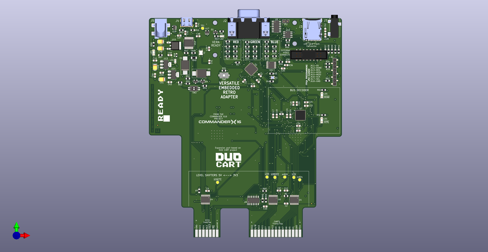
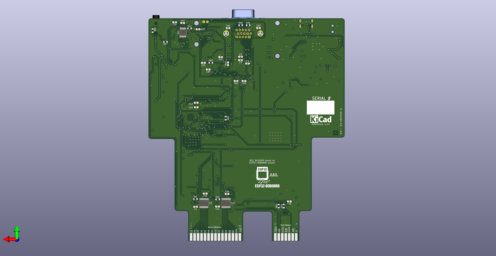
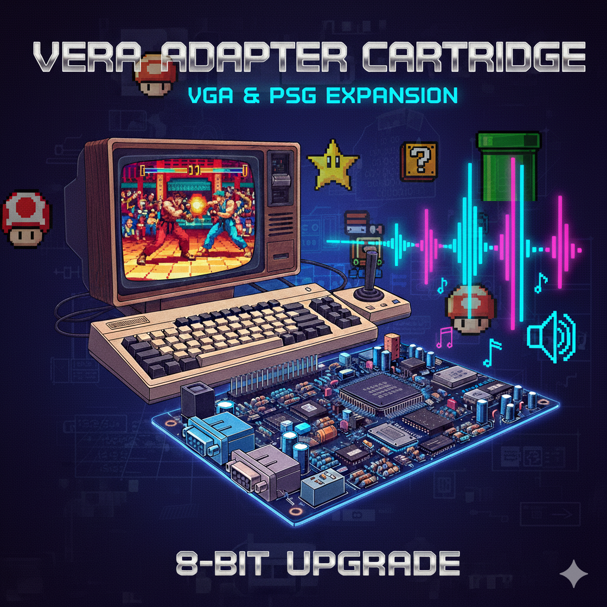
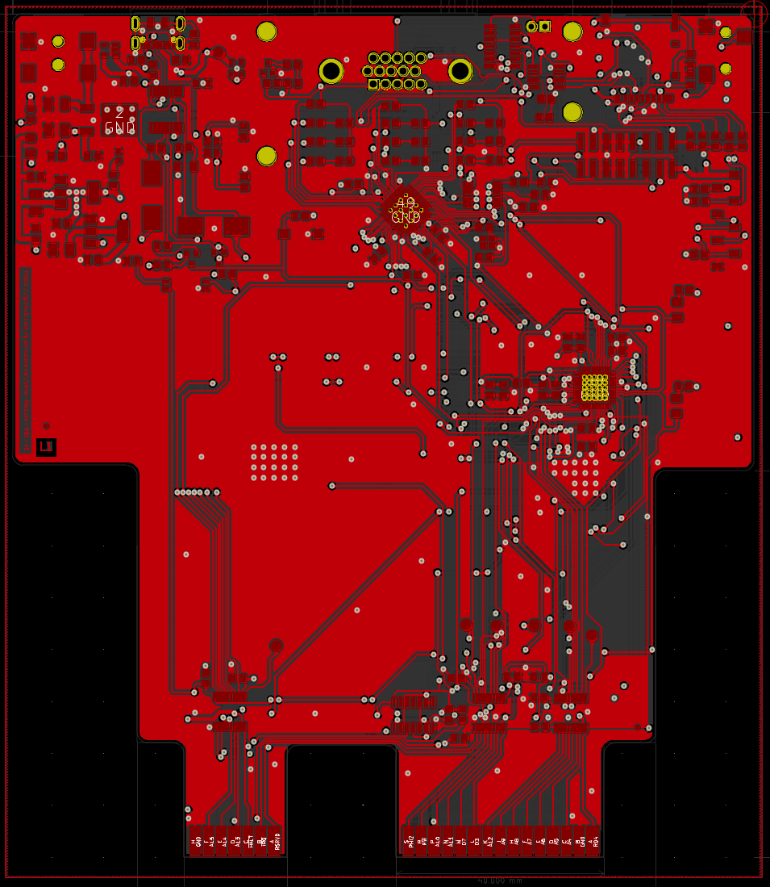
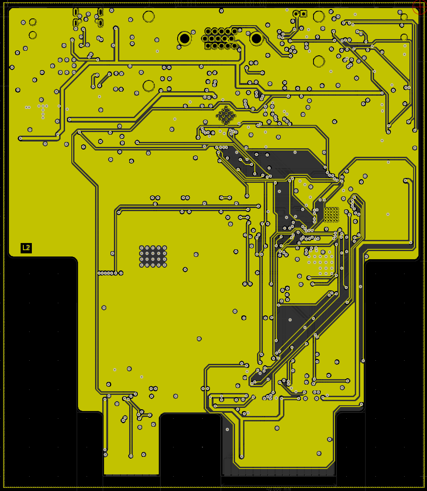
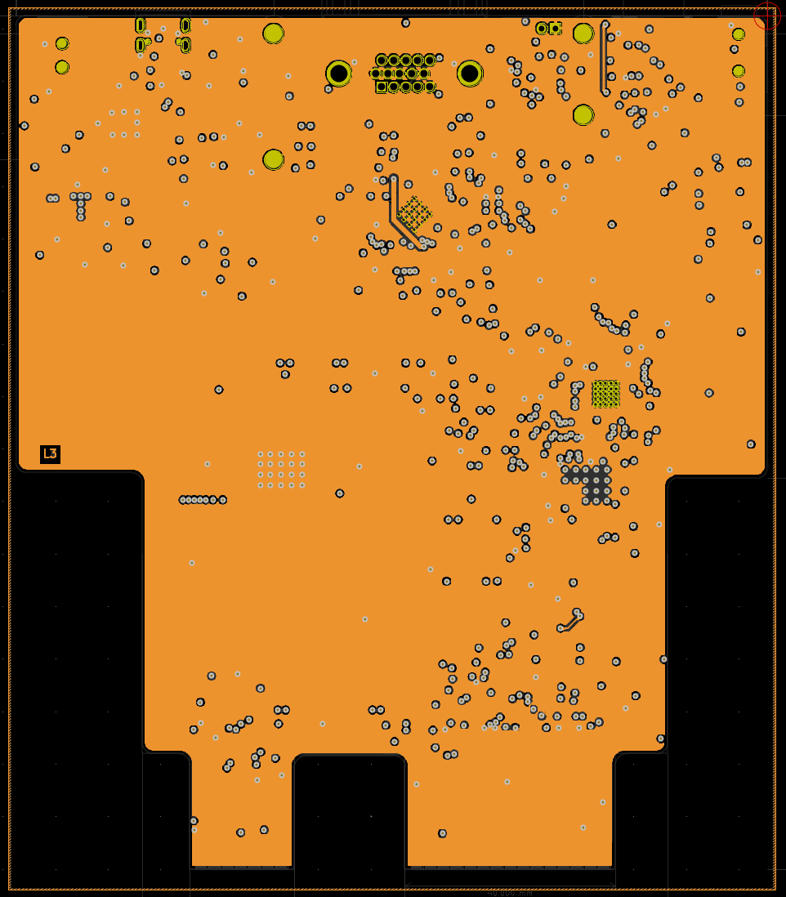
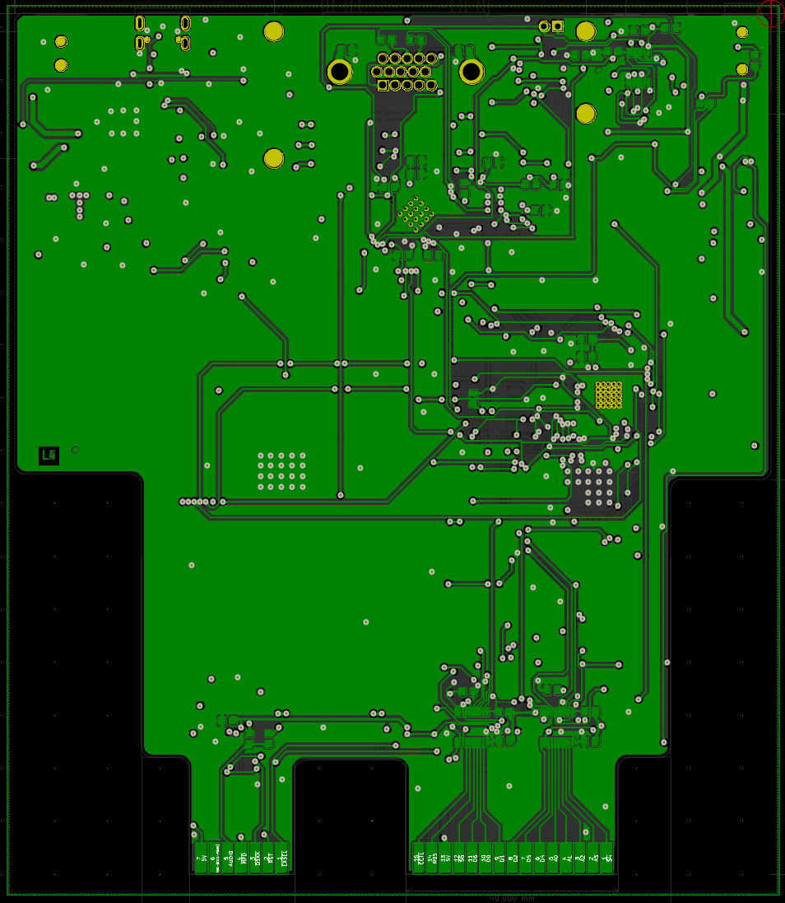

# VERA Module RBL-C64

<div align="center">

[](https://www.gnu.org/licenses/gpl-3.0)
[](https://www.kicad.org/)
[](#)
[](https://en.wikipedia.org/wiki/Commodore_64)
[](https://www.espressif.com/)

*🌐 English | [🌐 Italiano](#vera-module-rbl-c64-italiano)*

</div>

> [!WARNING]
> **WORK IN PROGRESS — NOT WORKING.**
> This project is under development and does **not** work yet. The board has not been built or
> tested; firmware (ESP32, FPGA) and documentation have only been checked in simulation or on
> paper and may contain errors. Do not manufacture the PCB or rely on this design yet.

---

<div style="background: #ffffff; border-radius: 16px; padding: 24px; margin: 24px 0; box-shadow: 0 4px 12px rgba(0,0,0,0.1); border: 1px solid #e0e0e0;">

## 📋 Table of Contents

- [🔍 Overview](#-overview)
- [✨ Features](#-features)
- [⚙️ Technical Specifications](#️-technical-specifications)
- [🔧 Hardware Components](#-hardware-components)
- [🖼️ Board Preview](#️-board-preview)
- [📐 PCB Layers](#-pcb-layers)
- [🔌 Connectors & Interfaces](#-connectors--interfaces)
- [⚡ Power Requirements](#-power-requirements)
- [🔨 Assembly Instructions](#-assembly-instructions)
- [📦 Bill of Materials](#-bill-of-materials)
- [💻 Programming & Configuration](#-programming--configuration)
- [📁 Project Structure](#-project-structure)
- [🤝 Contributing](#-contributing)
- [📄 License](#-license)

</div>

---

<div style="background: #ffffff; border-radius: 16px; padding: 24px; margin: 24px 0; box-shadow: 0 4px 12px rgba(0,0,0,0.1); border: 1px solid #e0e0e0;">

## 🔍 Overview

The **VERA Module RBL-C64** is an FPGA-based audio and video expansion card for the
**Commodore 64**. It plugs into the **expansion (cartridge) port** and adds, in the I/O
areas `IO1`/`IO2`, the VERA registers and a **256 KB GeoRAM** emulated by the ESP32.

> **Origin:** the project is derived from the ATARI version (VERA Module RBL-XE). The
> schematic is the RBL-XE one (2026-10-26 revision) with the connector sheet adapted to the
> C64 expansion port, and the ESP32-S3 pin mapping is the same as RBL-XE wherever possible;
> the netlist matches the schematic. **The PCB is still the ATARI one.** Changes are listed in
> [`PIN-MAPPING.md` § 9](PIN-MAPPING.md#9-modifiche-hardware-rispetto-alla-versione-atari).

### What is VERA?

**VERA** (Video Enhanced Retro Adapter) is originally designed for the 
Commander X16 computer, whose 65C02 bus is close to the 6510 one. It provides:

- **Advanced Graphics**: Multiple video layers, sprites, and high-resolution modes
- **Enhanced Audio**: Multi-channel digital audio with PCM and PSG capabilities  
- **Modern Connectivity**: VGA output, SD card storage, and USB programming
- **Retro Compatibility**: Integration with C64 software through a small register map

</div>

---

<div style="background: #ffffff; border-radius: 16px; padding: 24px; margin: 24px 0; box-shadow: 0 4px 12px rgba(0,0,0,0.1); border: 1px solid #e0e0e0;">

## ✨ Features

### 🎨 Graphics Capabilities

#### Video Output
- **VGA Output**: 640x480 @ 60Hz with analog RGB signals
- **Multiple Layers**: Background, foreground, and sprite layers
- **Color Depth**: 256 colors from a palette of 4096
- **Sprites**: Hardware-accelerated sprite engine
- **Scrolling**: Smooth horizontal and vertical scrolling

#### Audio Features
- **Digital Audio**: High-quality PCM audio output
- **Multi-channel**: Stereo audio
- **Audio Codec**: WM8524 for professional audio quality
- **3.5mm Jack**: Standard audio output connector

### 🔗 System Integration

#### Commodore 64 Compatibility
- **Expansion Port**: Direct connection to the C64 cartridge port, no ROM mapping (`/GAME`, `/EXROM` unused)
- **I/O Mapping**: VERA registers at `$DF00–$DF1F`, select latch at `$DFFD`, GeoRAM window at `$DE00–$DEFF` with page/block registers at `$DFFE`/`$DFFF`
- **GeoRAM 256 KB**: emulated in the ESP32 RAM, register compatible with the original cartridge
- **Bus Decoder**: cycles qualified by the C64 `/IO1` and `/IO2` lines (CPU accesses only, VIC-II fetches ignored); A0–A7 give the offset
- **Power Management**: Efficient 5V to 3.3V/1.2V conversion

#### Storage & Programming
- **SD Card Slot**: Micro SD for data storage and ROM loading
- **SPI Flash**: 16Mbit W25Q16 for FPGA configuration
- **USB Programming**: CH340 USB-to-serial for easy updates
- **SPI**: Direct FPGA programming interface

</div>

---

<div style="background: #ffffff; border-radius: 16px; padding: 24px; margin: 24px 0; box-shadow: 0 4px 12px rgba(0,0,0,0.1); border: 1px solid #e0e0e0;">

## ⚙️ Technical Specifications

### Core Specifications

| Component | Specification |
|-----------|---------------|
| **FPGA** | Lattice ICE40UP5K-SG48ITR |
| **Microcontroller** | ESP32-S3FN8 |
| **Flash Memory** | W25Q16JVSNIQ (16Mbit) |
| **Audio Codec** | WM8524CGEDT |
| **USB Interface** | CH340T |
| **Power Regulators** | AMS1117-3.3V, AMS1117-1.2V, L7805 |
| **Crystal (VERA board)** | 25 MHz ECS-2033-250-BN (ICE40UP5K reference clock) |
| **Crystal (ESP32-S3)** | 40 MHz external — required; XTAL\_P (QFN56 pin 54) / XTAL\_N (pin 53) |
| **PCB Layers** | 4-layer (Signal/Power/GND/Signal) |
| **Board Size** | TBD mm x TBD mm |

### Electrical Characteristics

| Parameter | Min | Typ | Max | Unit |
|-----------|-----|-----|-----|------|
| **Supply Voltage** | 4.5 | 5.0 | 5.5 | V |
| **Current Consumption** | - | 800 | 1200 | mA |
| **Operating Temperature** | -10 | 25 | 70 | °C |
| **VGA Output Impedance** | - | 75 | - | Ω |
| **Audio Output Level** | - | 2.0 | - | Vrms |

</div>

---

<div style="background: #ffffff; border-radius: 16px; padding: 24px; margin: 24px 0; box-shadow: 0 4px 12px rgba(0,0,0,0.1); border: 1px solid #e0e0e0;">

## 🔧 Hardware Components

### Main Processing Units

#### FPGA - ICE40UP5K
- **Logic Elements**: 5,280 LUTs
- **Memory**: 120 Kbit BRAM, 1 Mbit SPRAM
- **I/O Pins**: 39 user I/O
- **Package**: QFN-48 (7x7mm)
- **Programming**: SPI configuration

#### ESP32-S3FN8
- **CPU**: Dual-core Xtensa LX7 @ 240 MHz
- **Memory**: 8 MB in-package Quad SPI flash, 512 KB SRAM
- **Connectivity**: Wi-Fi 802.11 b/g/n, Bluetooth 5 LE
- **GPIO**: 45 total (38 usable), all bidirectional
- **Package**: QFN-56 (7×7 mm)
- **Crystal**: requires an external **40 MHz crystal** on dedicated analog pins XTAL\_P (QFN56 pin 54) and XTAL\_N (pin 53) — mandatory for PLL startup; see PIN-MAPPING.md § 5
- **Role**: software 6510-bus controller — qualifies every cycle with `/IO1`/`/IO2`, reads A0–A7, R/W and D0–D7, drives `DEV_SEL_N` for the VERA registers and the data bus for GeoRAM reads; emulates the 256 KB GeoRAM in its internal RAM
- **Timing**: bus loop alone on Core 1 with interrupts masked (Core 0 prints the log on Serial); PHI2, R/W, `/IO1`, `/IO2` and `DEV_SEL_N` through **Dedicated GPIO** Xtensa TIE instructions (`ee.get_gpio_in` / `ee.wr_mask_gpio_out`, 1 CPU cycle) within the ~490 ns PHI2-high window of the ~1 MHz 6510 clock

### Interface Components

#### Audio System
- **Codec**: WM8524CGEDT (24-bit, 192kHz)
- **Interface**: From FPGA digital audio bus
- **Output**: 3.5mm stereo jack
- **SNR**: >100dB

#### Video System
- **Output**: 15-pin VGA connector
- **Resolution**: 640x480 @ 60Hz
- **Colors**: 8-bit RGB (256 colors)
- **Sync**: Separate H/V sync signals

</div>

---

<div style="background: #ffffff; border-radius: 16px; padding: 24px; margin: 24px 0; box-shadow: 0 4px 12px rgba(0,0,0,0.1); border: 1px solid #e0e0e0;">

## 🖼️ Board Preview

### 3D Renderings

#### Top View

*Top side showing main components and connectors (ATARI board, the C64 layout is not drawn yet)*

#### Bottom View  

*Bottom side with additional components*

#### Cartridge Adapter

*Cartridge interface adapter of the ATARI version*

### Board Dimensions

- **Length**: TBD mm
- **Width**: TBD mm  
- **Thickness**: 1.6mm (4-layer PCB)
- **Mounting**: Commodore 64 expansion port (2×22 edge contacts, 2.54 mm pitch)
- **Connectors**: Flat for space efficiency. It needs a custom 3D printed case

</div>

---

<div style="background: #ffffff; border-radius: 16px; padding: 24px; margin: 24px 0; box-shadow: 0 4px 12px rgba(0,0,0,0.1); border: 1px solid #e0e0e0;">

## 📐 PCB Layers

### Layer Stack-up

#### Layer 1 - Top Copper (F.Cu)

*Component placement and signal routing*

#### Layer 2 - Power Plane (POWER)

*5V, 3.3V, and 1.2V power distribution*

#### Layer 3 - Ground Plane (GND)

*Solid ground plane for signal integrity*

#### Layer 4 - Bottom Copper (B.Cu)

*Additional signal routing and components*

</div>

---

<div style="background: #ffffff; border-radius: 16px; padding: 24px; margin: 24px 0; box-shadow: 0 4px 12px rgba(0,0,0,0.1); border: 1px solid #e0e0e0;">

## 🔌 Connectors & Interfaces

### External Connections

#### Commodore 64 Expansion Port
- **Connector**: expansion (cartridge) port, 2×22 edge contacts, 2.54 mm pitch
- **Address Range**: `IO1` $DE00–$DEFF, `IO2` $DF00–$DFFF
- **Signals used**: D0–D7, A0–A15, PHI2, R/W, `/IO1`, `/IO2`, `/RESET`, `/IRQ`; `BA` and `/DMA` only to test points
- **Unused lines**: `/GAME`, `/EXROM`, `/ROML`, `/ROMH`, `/NMI`, Dot Clock — left unconnected
- **Outputs**: `/IRQ` and `/RESET` through the open-drain buffers `U26` and `U27` (SN74LVC1G07): the board only pulls the shared lines low
- **No audio input** on the expansion port: the VERA audio mix is on test point `TP5`

#### Video Output (J2)
| Pin | Signal | Description |
|-----|--------|-------------|
| 1-3 | RGB | Red, Green, Blue analog signals |
| 13-14 | H/V Sync | Horizontal/Vertical sync |
| 6-10 | GND | Ground connections |
| 11-12 | Audio L/R | Stereo audio output |

#### Storage Interfaces
- **SD Card Slot (J3)**: Micro SD card interface
- **SPI Flash**: On-board 16Mbit storage
- **USB Port (J4)**: Programming and data transfer

### Programming Interfaces

#### ICEPROG Connector (J6)
| Pin | Signal | Function |
|-----|--------|----------|
| 1 | 5V | Power supply |
| 2 | FPGA_CDONE/PULL-UP | FPGA Programmed |
| 3 | FPGA_RESET | FPGA Reset |
| 4 | MISO | SPI data in |
| 5 | MOSI | SPI data out |
| 6 | SCK | SPI clock |
| 7 | SS | SPI select |
| 8 | GND | Ground |

#### Reset & Control
- **Reset Button (SW1)**: ESP32 system reset
- **DIP Switch (SW2)**: Configuration options
- **Status LEDs**: Power, programming, activity indicators

</div>

---

<div style="background: #ffffff; border-radius: 16px; padding: 24px; margin: 24px 0; box-shadow: 0 4px 12px rgba(0,0,0,0.1); border: 1px solid #e0e0e0;">

## ⚡ Power Requirements

### Power Distribution

#### Power Rails
| Rail | Voltage | Current | Components |
|------|---------|---------|------------|
| **5V** | 5.0V ± 5% | 200mA | Input from the C64 expansion port, USB |
| **3.3V** | 3.3V ± 3% | 400mA | ESP32, logic, interfaces |
| **1.2V** | 1.2V ± 3% | 300mA | FPGA core voltage |

#### Power Sources
1. **C64 expansion port**: Primary 5V supply from the computer (shared with the C64: check the board consumption against the power supply budget)
2. **USB**: Alternative 5V for programming/testing
3. **External**: Optional external 5V supply (J5)

#### Power Protection
- **Ideal diodes** (`U17`, `U18` MAX40200) on the jack and USB inputs; **no diode on the C64 5 V**: program the board and use USB/jack only with the board out of the C64 (`VERA-C64-HW-REQUIREMENTS.md` §2.11)
- **Ferrite Beads**: EMI filtering
- **Decoupling**: Extensive capacitor network
- **Current Limiting**: Overcurrent protection

</div>

---

<div style="background: #ffffff; border-radius: 16px; padding: 24px; margin: 24px 0; box-shadow: 0 4px 12px rgba(0,0,0,0.1); border: 1px solid #e0e0e0;">

## 🔨 Assembly Instructions

### Component Assembly

#### Assembly Order
1. **SMD Components**: Start with smallest components (0603, 0805)
2. **ICs**: Place all integrated circuits
3. **Connectors**: Install all external connectors
4. **Through-hole**: Add any remaining THT components
5. **Testing**: Verify power rails before first power-on

#### Special Considerations
- **FPGA**: Use proper ESD precautions
- **BGA Components**: Requires professional assembly
- **Thermal Management**: Ensure adequate cooling
- **Impedance Control**: Maintain 50Ω for high-speed signals

### Testing & Validation

#### Power-On Tests
1. **Visual Inspection**: Check for shorts, proper orientation
2. **Power Rails**: Verify all voltages within tolerance
3. **Clock Signals**: Confirm oscillator operation
4. **Communication**: Test SPI, I2C, UART interfaces

#### Functional Tests
1. **FPGA Programming**: Load test bitstream
2. **Video Output**: Verify VGA signal generation
3. **Audio Output**: Test audio codec functionality
4. **C64 Interface**: Confirm the select latch ($DFFD), the VERA registers ($DF00–$DF1F) and GeoRAM read/write ($DE00, $DFFE/$DFFF)

</div>

---

<div style="background: #ffffff; border-radius: 16px; padding: 24px; margin: 24px 0; box-shadow: 0 4px 12px rgba(0,0,0,0.1); border: 1px solid #e0e0e0;">

## 📦 Bill of Materials

### Component Categories

#### Major Components
- **1x** ICE40UP5K-SG48ITR FPGA
- **1x** ESP32-S3FN8 Microcontroller  
- **1x** W25Q16JVSNIQ SPI Flash
- **1x** WM8524CGEDT Audio Codec
- **1x** CH340T USB Interface

#### Passive Components
- **23x** 1µF Capacitors (1206)
- **20x** 100nF Capacitors (1206)
- **6x** 10µF Capacitors (1206)
- **Various** Resistors (0805/1206)
- **1x** 25 MHz Crystal Oscillator (VERA board — ICE40UP5K reference clock)
- **1x** 40 MHz Crystal + 2×10 pF load capacitors (ESP32-S3 — mandatory)

#### Connectors
- **1x** 15-pin VGA Connector
- **1x** Micro SD Card Slot
- **1x** USB Type-C Connector
- **1x** 3.5mm Audio Jack
- **1x** 8-pin Programming Header

### Cost Analysis

| Category | Estimated Cost | Percentage |
|----------|----------------|------------|
| **FPGA** | $15-20 | 35% |
| **ESP32** | $8-12 | 20% |
| **Connectors** | $5-8 | 15% |
| **Passives** | $3-5 | 10% |
| **PCB** | $8-12 | 20% |
| **Total** | **$39-57** | **100%** |

*Costs are estimates for small quantity production*

</div>

---

<div style="background: #ffffff; border-radius: 16px; padding: 24px; margin: 24px 0; box-shadow: 0 4px 12px rgba(0,0,0,0.1); border: 1px solid #e0e0e0;">

## 💻 Programming & Configuration

### FPGA Programming

#### Programming Methods
1. **USB/Serial**: Using FTDI 232H adapter interface with iceprog
2. **SPI Direct**: Direct SPI flash programming

#### Programming Steps
```bash
# Install icestorm toolchain
sudo apt install fpga-icestorm

# Program FPGA via USB (The FPGA bitstream is not provided!)
iceprog vera_module.bin

# Verify programming
iceprog -c
```

#### Development Tools
- **IceStorm**: Open-source FPGA toolchain
- **Yosys**: Verilog synthesis
- **NextPNR**: Place and route
- **KiCad**: PCB design and layout

### ESP32 Configuration

#### ESP32 Firmware
The ESP32-S3FN8 handles:
- **Core split**: the bus loop (`MonitorTask`) runs alone on **Core 1** with interrupts masked and never yields; **Core 0** runs `LogTask`, which prints on Serial the events passed through a lock-free ring buffer (same architecture as RBL-XE)
- **Startup sync**: ARESET and CRESET asserted LOW immediately in `setup()`. `setup()` enables the address translators (`ABUS_OE_N`, GPIO 47, after the strapping pins are latched), releases CRESET, polls CDONE until the ICE40UP5K bitstream is loaded (< 100 ms typical, 5 s timeout) and waits for the VERA power-on reset; `MonitorTask` then releases ARESET — the C64 starts with bus and FPGA already ready
- **Cycle qualification**: after the PHI2 rising edge the loop waits, for at most `IO_QUALIFY_NS` (200 ns), for `/IO1` or `/IO2`; other cycles, including VIC-II fetches, are skipped untouched
- **Critical path in inline assembly**: once `/IOx` is seen, 5 instructions + 1 APB read to `DEV_SEL_N`, ~10 instructions to the GeoRAM byte on the bus (two posted stores); IO2 decoded by a table in `include/bus_decode.h`, checked by a host test
- **GeoRAM**: 256 KB in ordinary DRAM `.bss`; D0–D7 driven via `GPIO.out` for reads of the `$DE00` window, from a pointer to the current page updated only on `$DFFE`/`$DFFF` writes
- **Writes**: the 6510 data is sampled `BUS_WR_SAMPLE_NS` (300 ns) after PHI2 rises; side effects are applied in the rest of PHI2
- **Debugging**: UART0 on GPIO43 (TX) / GPIO44 (RX), 115200 baud

I/O map (single build, `esp32s3fn8`):

| Address | Access | Function | Responds |
|---------|--------|----------|----------|
| `$DE00–$DEFF` | R/W | GeoRAM window (256-byte page) | ESP32 |
| `$DF00–$DF1F` | R/W | VERA registers | FPGA, `DEV_SEL_N` asserted |
| `$DFFD` | W | VERA select latch: non-zero selects, `0` deselects | ESP32 (snoop) |
| `$DFFE` | W | GeoRAM page register (0–63) | ESP32 (snoop) |
| `$DFFF` | W | GeoRAM block register (0–15) | ESP32 (snoop) |

The VERA responds **only while selected** through `$DFFD`; the GeoRAM (window and
registers) is **always active**, like the original cartridge, so existing GeoRAM software
works without touching `$DFFD`.
GeoRAM offset = block × 16384 + page × 256 + (addr & $FF). The registers are write-only,
cleared at power-on and kept across a C64 reset, like the original cartridge. They are
decoded exactly at `$DFFE`/`$DFFF` (no `$DF80–$DFFD` mirrors), so the latch at `$DFFD`
does not collide with them.

```
LDA #$04 : STA $DFFF   ; GeoRAM block 4 (always active)
LDA #$23 : STA $DFFE   ; GeoRAM page 35
LDA $DE45              ; GeoRAM byte $12345
LDA #$01 : STA $DFFD   ; select the VERA at $DF00-$DF1F
LDA #$00 : STA $DFFD   ; deselect the VERA
```

Details, timing analysis and critical-path figures: [`firmware/MCU/README.md`](firmware/MCU/README.md)
and `firmware/MCU/Vera_Module_Analisys.ITA.pdf`.

#### Programming ESP32
The firmware is built with **PlatformIO** (install via `pip install platformio`):
```bash
# Build firmware
cd firmware/MCU
pio run -e esp32s3fn8

# Flash firmware — connect UART adapter to GPIO43/44
pio run -e esp32s3fn8 --target upload
```

> **Note**: USB CDC is disabled because GPIO 19 (USB D−) and GPIO 20 (USB D+) are reused
> as address lines A7 and A8. Use an external UART adapter on GPIO 43/44.

</div>

---

<div style="background: #ffffff; border-radius: 16px; padding: 24px; margin: 24px 0; box-shadow: 0 4px 12px rgba(0,0,0,0.1); border: 1px solid #e0e0e0;">

## 📁 Project Structure

### Repository Organization

```
Vera-Module-RBL-C64/
├── 📄 README.md                    # This documentation
├── 📄 PIN-MAPPING.md               # ESP32-S3 / level-shifter pin mapping, C64 port, changes vs. ATARI (§ 9)
├── 📄 VERA-C64-HW-REQUIREMENTS.md # VERA bus requirements & bring-up plan (from the ATARI version)
├── 📄 LICENSE                      # GPL v3 license
├── 📁 firmware/
│   ├── 📁 MCU/                     # ESP32-S3 firmware (PlatformIO), analysis document
│   └── 📁 FPGA/                    # iCE40UP5K bus interface (C6502_Interface.vhd)
├── ⚙️ VERA-MODULE-RBL.pro         # KiCad project file
├── 📄 VERA-MODULE-RBL.sch         # Main schematic
├── 🔧 VERA-MODULE-RBL.kicad_pcb   # PCB layout
├── 📄 VERA-MODULE-RBL.csv         # Bill of materials
├── 🐍 jlcpcb-check-bom.py        # BOM processing script
├── 📁 images/                      # Board images and renders
│   ├── 🖼️ VERA-MODULE-RBL-TOP.png
│   ├── 🖼️ VERA-MODULE-RBL-BOTTOM.png
│   ├── 🖼️ F.Cu-L1.png            # PCB layer images
│   ├── 🖼️ POWER-L2.png
│   ├── 🖼️ GND-L3.png
│   └── 🖼️ B.Cu-L4.png
├── 📁 production/                  # Manufacturing files
│   ├── 📄 *.gbl, *.gtl            # Gerber files
│   ├── 📄 *.drl                   # Drill files
│   └── 📄 *.gbrjob                # Job files
├── 📁 ibom/                       # Interactive BOM
│   └── 🌐 ibom.html
└── 📁 schematics/                 # Individual schematics
    ├── 📄 vera-fpga.sch           # FPGA module
    ├── 📄 busdecoder.sch          # Bus decoder
    ├── 📄 cartridgeInterface.sch   # Cartridge interface
    ├── 📄 vera-fpga-flash.sch     # Flash memory
    └── 📄 powersupply.sch         # Power management
```

### Hardware notes (read before bring-up)

- [`PIN-MAPPING.md` § 9](PIN-MAPPING.md#9-modifiche-hardware-rispetto-alla-versione-atari) —
  changes from the ATARI board, now in schematic and netlist: expansion port connector,
  `/IO1`/`/IO2` inputs on GPIO 41/42 through `U6`, `U19` output-enable gating with
  `DEV_SEL_N` and `/IO1`, open-drain `/IRQ` and `/RESET`; the PCB is still to be redone.
- [`VERA-C64-HW-REQUIREMENTS.md`](VERA-C64-HW-REQUIREMENTS.md) — what the VERA FPGA
  requires from the bus (separate RD/WR, write data hold, read side effects, reconfiguration),
  adapted to the C64 from the RBL-XE document, plus the bring-up test plan.

### Design Files

#### KiCad Files
- **Schematic**: Multi-sheet hierarchical design
- **PCB Layout**: 4-layer board with controlled impedance
- **3D Models**: Custom component models
- **Footprints**: Custom connector footprints

#### Manufacturing Files
- **Gerber Files**: Industry-standard PCB fabrication
- **Drill Files**: NC drill and via specifications  
- **Pick & Place**: SMT assembly coordinates
- **BOM**: Component specifications with LCSC part numbers

</div>

---

<div style="background: #ffffff; border-radius: 16px; padding: 24px; margin: 24px 0; box-shadow: 0 4px 12px rgba(0,0,0,0.1); border: 1px solid #e0e0e0;">

## 🤝 Contributing

### Development Guidelines

#### Contributing Process
1. **Fork** the repository
2. **Create** a feature branch
3. **Make** your changes
4. **Test** thoroughly
5. **Submit** a pull request

#### Contribution Areas
- **Hardware Design**: PCB layout improvements
- **Firmware**: ESP32 and FPGA code
- **Documentation**: User guides and tutorials
- **Testing**: Validation and verification
- **Software**: Host applications and tools

#### Design Goals
- **Compatibility**: Maintain Commodore 64 compatibility (PAL and NTSC)
- **Performance**: Optimize for speed and efficiency
- **Reliability**: Ensure robust operation
- **Manufacturability**: Design for production
- **Cost**: Balance features with affordability

</div>

---

<div style="background: #ffffff; border-radius: 16px; padding: 24px; margin: 24px 0; box-shadow: 0 4px 12px rgba(0,0,0,0.1); border: 1px solid #e0e0e0;">

## 📄 License

This project is licensed under the **GNU General Public License v3.0**.

### License Details

#### Permissions
- ✅ Commercial use
- ✅ Modification
- ✅ Distribution
- ✅ Patent use
- ✅ Private use

#### Limitations
- ❌ Liability
- ❌ Warranty

#### Conditions
- 📄 License and copyright notice
- 📄 State changes
- 📄 Disclose source
- 📄 Same license

For the complete license text, see the [LICENSE](LICENSE) file.

</div>

---

<div style="background: linear-gradient(135deg, #1976d2, #42a5f5); color: white; border-radius: 16px; padding: 32px; margin: 32px 0; box-shadow: 0 8px 24px rgba(25,118,210,0.3); text-align: center;">

## 💙 Support the Project

If you find this project useful, please consider:

🌟 **Starring** the repository  
🐛 **Reporting** issues  
🔧 **Contributing** improvements  
📢 **Sharing** with the community  

---

**Made with ❤️ by RetroBit Lab**

*Bringing modern capabilities to classic computers*

</div>

---

# VERA Module RBL-C64 (Italiano)

<div align="center">

*[🌐 English](#vera-module-rbl-c64) | 🌐 Italiano*

</div>

> [!WARNING]
> **LAVORO IN CORSO — NON FUNZIONANTE.**
> Il progetto è in fase di sviluppo e **non** funziona ancora. La scheda non è stata realizzata né
> provata; firmware (ESP32, FPGA) e documentazione sono stati verificati solo in simulazione o sulla
> carta e possono contenere errori. Non produrre il PCB e non fare affidamento su questo progetto.

---

<div style="background: #ffffff; border-radius: 16px; padding: 24px; margin: 24px 0; box-shadow: 0 4px 12px rgba(0,0,0,0.1); border: 1px solid #e0e0e0;">

## 📋 Indice

- [🔍 Panoramica](#-panoramica)
- [✨ Caratteristiche](#-caratteristiche)
- [⚙️ Specifiche Tecniche](#️-specifiche-tecniche)
- [🔧 Componenti Hardware](#-componenti-hardware)
- [🖼️ Anteprima Scheda](#️-anteprima-scheda)
- [📐 Layer PCB](#-layer-pcb)
- [🔌 Connettori e Interfacce](#-connettori-e-interfacce)
- [⚡ Requisiti di Alimentazione](#-requisiti-di-alimentazione)
- [🔨 Istruzioni di Assemblaggio](#-istruzioni-di-assemblaggio)
- [📦 Distinta Materiali](#-distinta-materiali)
- [💻 Programmazione e Configurazione](#-programmazione-e-configurazione)
- [📁 Struttura Progetto](#-struttura-progetto)
- [🤝 Contribuire](#-contribuire)
- [📄 Licenza](#-licenza-1)

</div>

---

<div style="background: #ffffff; border-radius: 16px; padding: 24px; margin: 24px 0; box-shadow: 0 4px 12px rgba(0,0,0,0.1); border: 1px solid #e0e0e0;">

## 🔍 Panoramica

Il **VERA Module RBL-C64** è una scheda di espansione audio e video basata su FPGA per il
**Commodore 64**. Si collega alla **porta di espansione (cartuccia)** e aggiunge, nelle aree
I/O `IO1`/`IO2`, i registri VERA e una **GeoRAM da 256 KB** emulata dall'ESP32.

> **Origine:** il progetto deriva dalla versione ATARI (VERA Module RBL-XE). Lo schema è
> quello di RBL-XE (revisione del 2026-10-26) con il foglio del connettore adattato alla porta
> di espansione del C64, e la piedinatura dell'ESP32-S3 è la stessa di RBL-XE dove possibile;
> la netlist è allineata allo schema. **Il PCB è ancora quello ATARI.** Le modifiche sono in
> [`PIN-MAPPING.md` § 9](PIN-MAPPING.md#9-modifiche-hardware-rispetto-alla-versione-atari).

### Cos'è VERA?

**VERA** (Video Enhanced Retro Adapter) è originariamente progettato per il 
computer Commander X16, il cui bus 65C02 è molto vicino a quello del 6510. Fornisce:

- **Grafica Avanzata**: Livelli video multipli, sprite e modalità ad alta risoluzione
- **Audio Migliorato**: Audio digitale multicanale con capacità PCM e PSG
- **Connettività Moderna**: Uscita VGA, storage su scheda SD e programmazione USB
- **Compatibilità Retro**: Integrazione con il software C64 tramite una piccola mappa di registri

</div>

---

<div style="background: #ffffff; border-radius: 16px; padding: 24px; margin: 24px 0; box-shadow: 0 4px 12px rgba(0,0,0,0.1); border: 1px solid #e0e0e0;">

## ✨ Caratteristiche

### 🎨 Capacità Grafiche

#### Uscita Video
- **Uscita VGA**: 640x480 @ 60Hz con segnali RGB analogici
- **Livelli Multipli**: Livelli di sfondo, primo piano e sprite
- **Profondità Colore**: 256 colori da una palette di 4096
- **Sprite**: Motore sprite accelerato hardware
- **Scrolling**: Scorrimento orizzontale e verticale fluido

#### Caratteristiche Audio
- **Audio Digitale**: Uscita audio PCM di alta qualità
- **Multicanale**: Audio stereo
- **Codec Audio**: WM8524 per qualità audio professionale
- **Jack 3.5mm**: Connettore uscita audio standard

### 🔗 Integrazione Sistema

#### Compatibilità Commodore 64
- **Porta di espansione**: Connessione diretta alla porta cartuccia del C64, senza mappare ROM (`/GAME`, `/EXROM` non usati)
- **Mappa I/O**: registri VERA a `$DF00–$DF1F`, latch di selezione a `$DFFD`, finestra GeoRAM a `$DE00–$DEFF` con i registri pagina/blocco a `$DFFE`/`$DFFF`
- **GeoRAM 256 KB**: emulata nella RAM dell'ESP32, compatibile a livello di registri con la cartuccia originale
- **Decodificatore Bus**: cicli qualificati dalle linee `/IO1` e `/IO2` del C64 (solo accessi CPU, fetch del VIC-II ignorati); A0–A7 danno l'offset
- **Gestione Alimentazione**: Conversione efficiente da 5V a 3.3V/1.2V

#### Storage e Programmazione
- **Slot Scheda SD**: Micro SD per storage dati e caricamento ROM
- **Flash SPI**: 16Mbit W25Q16 per configurazione FPGA
- **Programmazione USB**: CH340 USB-to-serial per aggiornamenti facili
- **SPI**: Interfaccia programmazione FPGA diretta

</div>

---

<div style="background: #ffffff; border-radius: 16px; padding: 24px; margin: 24px 0; box-shadow: 0 4px 12px rgba(0,0,0,0.1); border: 1px solid #e0e0e0;">

## ⚙️ Specifiche Tecniche

### Specifiche Principali

| Componente | Specifica |
|------------|-----------|
| **FPGA** | Lattice ICE40UP5K-SG48ITR |
| **Microcontrollore** | ESP32-S3FN8 |
| **Memoria Flash** | W25Q16JVSNIQ (16Mbit) |
| **Codec Audio** | WM8524CGEDT |
| **Interfaccia USB** | CH340T |
| **Regolatori Alimentazione** | AMS1117-3.3V, AMS1117-1.2V, L7805 |
| **Cristallo (scheda VERA)** | 25 MHz ECS-2033-250-BN (clock di riferimento ICE40UP5K) |
| **Cristallo (ESP32-S3)** | 40 MHz esterno — obbligatorio; XTAL\_P (QFN56 pin 54) / XTAL\_N (pin 53) |
| **Layer PCB** | 4 layer (Segnale/Alimentazione/GND/Segnale) |
| **Dimensioni Scheda** | TBD mm x TBD mm |

### Caratteristiche Elettriche

| Parametro | Min | Tip | Max | Unità |
|-----------|-----|-----|-----|-------|
| **Tensione Alimentazione** | 4.5 | 5.0 | 5.5 | V |
| **Consumo Corrente** | - | 800 | 1200 | mA |
| **Temperatura Operativa** | -10 | 25 | 70 | °C |
| **Impedenza Uscita VGA** | - | 75 | - | Ω |
| **Livello Uscita Audio** | - | 2.0 | - | Vrms |

</div>

---

<div style="background: #ffffff; border-radius: 16px; padding: 24px; margin: 24px 0; box-shadow: 0 4px 12px rgba(0,0,0,0.1); border: 1px solid #e0e0e0;">

## 🔧 Componenti Hardware

### Unità di Elaborazione Principali

#### FPGA - ICE40UP5K
- **Elementi Logici**: 5,280 LUT
- **Memoria**: 120 Kbit BRAM, 1 Mbit SPRAM
- **Pin I/O**: 39 I/O utente
- **Package**: QFN-48 (7x7mm)
- **Programmazione**: Configurazione SPI

#### ESP32-S3FN8
- **CPU**: Dual-core Xtensa LX7 @ 240 MHz
- **Memoria**: 8 MB flash Quad SPI integrata, 512 KB SRAM
- **Connettività**: Wi-Fi 802.11 b/g/n, Bluetooth 5 LE
- **GPIO**: 45 totali (38 usabili), tutti bidirezionali
- **Package**: QFN-56 (7×7 mm)
- **Quarzo**: richiede un **quarzo esterno 40 MHz** sui pin analogici dedicati XTAL\_P (QFN56 pin 54) e XTAL\_N (pin 53) — obbligatorio per il PLL di avvio; vedere PIN-MAPPING.md § 5
- **Ruolo**: controllore software del bus 6510 — qualifica ogni ciclo con `/IO1`/`/IO2`, legge A0–A7, R/W e D0–D7, pilota `DEV_SEL_N` per i registri VERA e il bus dati per le letture GeoRAM; emula la GeoRAM da 256 KB nella propria RAM
- **Tempi**: loop del bus da solo sul Core 1 a interruzioni mascherate (il Core 0 stampa il log su Serial); PHI2, R/W, `/IO1`, `/IO2` e `DEV_SEL_N` tramite istruzioni **Dedicated GPIO** Xtensa TIE (1 ciclo CPU) nella finestra di PHI2 alto di ~490 ns del clock 6510 a ~1 MHz

### Componenti Interfaccia

#### Sistema Audio
- **Codec**: WM8524CGEDT (24-bit, 192kHz)
- **Interfaccia**: Audio digitale dalla FPGA con bus dedicato
- **Uscita**: Jack stereo 3.5mm
- **SNR**: >100dB

#### Sistema Video
- **Uscita**: Connettore VGA 15-pin
- **Risoluzione**: 640x480 @ 60Hz
- **Colori**: RGB 8-bit (256 colori)
- **Sync**: Segnali H/V sync separati

</div>

---

<div style="background: #ffffff; border-radius: 16px; padding: 24px; margin: 24px 0; box-shadow: 0 4px 12px rgba(0,0,0,0.1); border: 1px solid #e0e0e0;">

## 🖼️ Anteprima Scheda

### Rendering 3D

#### Vista Superiore

*Lato superiore con componenti principali e connettori (scheda ATARI, il layout C64 non è ancora disegnato)*

#### Vista Inferiore

*Lato inferiore con componenti aggiuntivi*

#### Adattatore Cartuccia

*Adattatore cartuccia della versione ATARI*

### Dimensioni Scheda

- **Lunghezza**: TBD mm
- **Larghezza**: TBD mm  
- **Spessore**: 1.6mm (PCB 4-layer)
- **Montaggio**: porta di espansione del Commodore 64 (2×22 contatti a pettine, passo 2,54 mm)
- **Connettori**: Piatti per efficienza spazio. Necessita di case stampato in 3D

</div>

---

<div style="background: #ffffff; border-radius: 16px; padding: 24px; margin: 24px 0; box-shadow: 0 4px 12px rgba(0,0,0,0.1); border: 1px solid #e0e0e0;">

## 📐 Layer PCB

### Stack-up Layer

#### Layer 1 - Rame Superiore (F.Cu)

*Posizionamento componenti e routing segnali*

#### Layer 2 - Piano Alimentazione (POWER)

*Distribuzione alimentazione 5V, 3.3V e 1.2V*

#### Layer 3 - Piano Massa (GND)

*Piano massa solido per integrità segnale*

#### Layer 4 - Rame Inferiore (B.Cu)

*Routing segnali aggiuntivo e componenti*

</div>

---

<div style="background: #ffffff; border-radius: 16px; padding: 24px; margin: 24px 0; box-shadow: 0 4px 12px rgba(0,0,0,0.1); border: 1px solid #e0e0e0;">

## 🔌 Connettori e Interfacce

### Connessioni Esterne

#### Porta di espansione Commodore 64
- **Connettore**: porta di espansione (cartuccia), 2×22 contatti a pettine, passo 2,54 mm
- **Range Indirizzi**: `IO1` $DE00–$DEFF, `IO2` $DF00–$DFFF
- **Segnali usati**: D0–D7, A0–A15, PHI2, R/W, `/IO1`, `/IO2`, `/RESET`, `/IRQ`; `BA` e `/DMA` solo verso test point
- **Linee non usate**: `/GAME`, `/EXROM`, `/ROML`, `/ROMH`, `/NMI`, Dot Clock — scollegate
- **Uscite**: `/IRQ` e `/RESET` attraverso i buffer open-drain `U26` e `U27` (SN74LVC1G07): la scheda tira solo in basso le linee condivise
- **Nessun ingresso audio** sulla porta di espansione: il mix audio della VERA è sul test point `TP5`

#### Uscita Video (J2)
| Pin | Segnale | Descrizione |
|-----|---------|-------------|
| 1-3 | RGB | Segnali analogici Rosso, Verde, Blu |
| 13-14 | H/V Sync | Sync orizzontale/verticale |
| 6-10 | GND | Connessioni massa |
| 11-12 | Audio L/R | Uscita audio stereo |

#### Interfacce Storage
- **Slot Scheda SD (J3)**: Interfaccia scheda Micro SD
- **Flash SPI**: Storage on-board 16Mbit
- **Porta USB (J4)**: Programmazione e trasferimento dati

### Interfacce Programmazione

#### Connettore ICEPROG (J6)
| Pin | Segnale | Funzione |
|-----|--------|----------|
| 1 | 5V | Alimentazione |
| 2 | FPGA_CDONE/PULL-UP | FPGA Programmata |
| 3 | FPGA_RESET | FPGA Reset |
| 4 | MISO | Dati SPI in ingresso |
| 5 | MOSI | Dati SPI in uscita |
| 6 | SCK | Clock SPI |
| 7 | SS | Selezione SPI |
| 8 | GND | Ground |

#### Reset e Controllo
- **Pulsante Reset (SW1)**: Reset sistema ESP32
- **DIP Switch (SW2)**: Opzioni configurazione
- **LED di Stato**: Indicatori alimentazione, programmazione, attività

</div>

---

<div style="background: #ffffff; border-radius: 16px; padding: 24px; margin: 24px 0; box-shadow: 0 4px 12px rgba(0,0,0,0.1); border: 1px solid #e0e0e0;">

## ⚡ Requisiti di Alimentazione

### Distribuzione Alimentazione

#### Rail Alimentazione
| Rail | Tensione | Corrente | Componenti |
|------|----------|----------|------------|
| **5V** | 5.0V ± 5% | 200mA | Ingresso dalla porta di espansione C64, USB |
| **3.3V** | 3.3V ± 3% | 400mA | ESP32, logica, interfacce |
| **1.2V** | 1.2V ± 3% | 300mA | Tensione core FPGA |

#### Sorgenti Alimentazione
1. **Porta di espansione C64**: Alimentazione 5V primaria dal computer (condivisa con il C64: verificare il consumo della scheda rispetto all'alimentatore)
2. **USB**: 5V alternativo per programmazione/test
3. **Esterno**: Alimentazione 5V esterna opzionale (J5)

#### Protezione Alimentazione
- **Diodi ideali** (`U17`, `U18` MAX40200) sugli ingressi jack e USB; **nessun diodo sul 5 V del C64**: programmare e usare USB/jack solo con la scheda fuori dal C64 (`VERA-C64-HW-REQUIREMENTS.md` §2.11)
- **Perle di Ferrite**: Filtraggio EMI
- **Disaccoppiamento**: Rete estesa di condensatori
- **Limitazione Corrente**: Protezione sovracorrente

</div>

---

<div style="background: #ffffff; border-radius: 16px; padding: 24px; margin: 24px 0; box-shadow: 0 4px 12px rgba(0,0,0,0.1); border: 1px solid #e0e0e0;">

## 🔨 Istruzioni di Assemblaggio

### Assemblaggio Componenti

#### Ordine Assemblaggio
1. **Componenti SMD**: Iniziare con componenti più piccoli (0603, 0805)
2. **IC**: Posizionare tutti i circuiti integrati
3. **Connettori**: Installare tutti i connettori esterni
4. **Through-hole**: Aggiungere eventuali componenti THT rimanenti
5. **Test**: Verificare rail alimentazione prima della prima accensione

#### Considerazioni Speciali
- **FPGA**: Usare precauzioni ESD appropriate
- **Componenti BGA**: Richiede assemblaggio professionale
- **Gestione Termica**: Assicurare raffreddamento adeguato
- **Controllo Impedenza**: Mantenere 50Ω per segnali alta velocità

### Test e Validazione

#### Test Accensione
1. **Ispezione Visiva**: Controllare cortocircuiti, orientamento corretto
2. **Rail Alimentazione**: Verificare tutte le tensioni entro tolleranza
3. **Segnali Clock**: Confermare funzionamento oscillatore
4. **Comunicazione**: Testare interfacce SPI, I2C, UART

#### Test Funzionali
1. **Programmazione FPGA**: Caricare bitstream di test
2. **Uscita Video**: Verificare generazione segnale VGA
3. **Uscita Audio**: Testare funzionalità codec audio
4. **Interfaccia C64**: Verificare latch di selezione ($DFFD), registri VERA ($DF00–$DF1F) e lettura/scrittura GeoRAM ($DE00, $DFFE/$DFFF)

</div>

---

<div style="background: #ffffff; border-radius: 16px; padding: 24px; margin: 24px 0; box-shadow: 0 4px 12px rgba(0,0,0,0.1); border: 1px solid #e0e0e0;">

## 📦 Distinta Materiali

### Categorie Componenti

#### Componenti Principali
- **1x** ICE40UP5K-SG48ITR FPGA
- **1x** ESP32-S3FN8 Microcontrollore
- **1x** W25Q16JVSNIQ Flash SPI
- **1x** WM8524CGEDT Codec Audio
- **1x** CH340T Interfaccia USB

#### Componenti Passivi
- **23x** Condensatori 1µF (1206)
- **20x** Condensatori 100nF (1206)
- **6x** Condensatori 10µF (1206)
- **Vari** Resistori (0805/1206)
- **1x** Oscillatore Cristallo 25 MHz (scheda VERA — clock di riferimento ICE40UP5K)
- **1x** Quarzo 40 MHz + 2×10 pF condensatori di carico (ESP32-S3 — obbligatorio)

#### Connettori
- **1x** Connettore VGA 15-pin
- **1x** Slot Scheda Micro SD
- **1x** Connettore USB Type-C
- **1x** Jack Audio 3.5mm
- **1x** Header Programmazione 8-pin

### Analisi Costi

| Categoria | Costo Stimato | Percentuale |
|-----------|---------------|-------------|
| **FPGA** | $15-20 | 35% |
| **ESP32** | $8-12 | 20% |
| **Connettori** | $5-8 | 15% |
| **Passivi** | $3-5 | 10% |
| **PCB** | $8-12 | 20% |
| **Totale** | **$39-57** | **100%** |

*I costi sono stime per produzione piccole quantità*

</div>

---

<div style="background: #ffffff; border-radius: 16px; padding: 24px; margin: 24px 0; box-shadow: 0 4px 12px rgba(0,0,0,0.1); border: 1px solid #e0e0e0;">

## 💻 Programmazione e Configurazione

### Programmazione FPGA

#### Metodi Programmazione
1. **USB/Seriale**: Usando interfaccia FTDI 232H per SPI USB con iceprog
2. **SPI Diretto**: Programmazione flash SPI diretta

#### Passi Programmazione
```bash
# Installare toolchain icestorm
sudo apt install fpga-icestorm

# Programmare FPGA via USB (Il bitstream FPGA non e' fornito!)
iceprog vera_module.bin

# Verificare programmazione
iceprog -c
```

#### Strumenti Sviluppo
- **IceStorm**: Toolchain FPGA open-source
- **Yosys**: Sintesi Verilog
- **NextPNR**: Place and route
- **KiCad**: Design e layout PCB

### Configurazione ESP32

#### Firmware ESP32
L'ESP32-S3FN8 gestisce:
- **Divisione dei core**: il loop del bus (`MonitorTask`) gira da solo sul **Core 1** a interruzioni mascherate e non cede mai la CPU; il **Core 0** esegue `LogTask`, che stampa su Serial gli eventi ricevuti tramite un ring buffer senza lock (stessa architettura di RBL-XE)
- **Avvio sincronizzato**: ARESET e CRESET bassi subito in `setup()`. `setup()` abilita i traslatori degli indirizzi (`ABUS_OE_N`, GPIO 47, dopo il campionamento degli strapping), rilascia CRESET, attende CDONE (< 100 ms tipici, timeout 5 s) e il power-on reset della VERA; poi `MonitorTask` rilascia ARESET — il C64 parte con bus e FPGA già pronti
- **Qualificazione dei cicli**: dopo il fronte di salita di PHI2 il loop attende, per al massimo `IO_QUALIFY_NS` (200 ns), `/IO1` o `/IO2`; gli altri cicli, compresi i fetch del VIC-II, vengono saltati senza toccare nulla
- **Percorso critico in assembly inline**: visto `/IOx`, 5 istruzioni + 1 lettura APB fino a `DEV_SEL_N`, ~10 istruzioni fino al byte GeoRAM sul bus (due store "posted"); IO2 decodificato con una tabella in `include/bus_decode.h`, verificata da un test sul PC
- **GeoRAM**: 256 KB in `.bss` ordinaria in DRAM; D0–D7 pilotati via `GPIO.out` nelle letture della finestra `$DE00`, da un puntatore alla pagina corrente aggiornato solo quando si scrive `$DFFE`/`$DFFF`
- **Scritture**: il dato del 6510 è campionato `BUS_WR_SAMPLE_NS` (300 ns) dopo la salita di PHI2; gli effetti sono applicati nel resto di PHI2
- **Debug**: UART0 su GPIO43 (TX) / GPIO44 (RX), 115200 baud

Mappa I/O (build unica, `esp32s3fn8`):

| Indirizzo | Accesso | Funzione | Chi risponde |
|-----------|---------|----------|--------------|
| `$DE00–$DEFF` | R/W | Finestra GeoRAM (pagina da 256 byte) | ESP32 |
| `$DF00–$DF1F` | R/W | Registri VERA | FPGA, `DEV_SEL_N` asserito |
| `$DFFD` | W | Latch selezione VERA: valore ≠ 0 seleziona, `0` deseleziona | ESP32 (snoop) |
| `$DFFE` | W | GeoRAM registro pagina (0–63) | ESP32 (snoop) |
| `$DFFF` | W | GeoRAM registro blocco (0–15) | ESP32 (snoop) |

La VERA risponde **solo se selezionata** tramite `$DFFD`; la GeoRAM (finestra e registri)
è **sempre attiva**, come nella cartuccia originale, quindi il software GeoRAM esistente
funziona senza toccare `$DFFD`.
Offset GeoRAM = blocco × 16384 + pagina × 256 + (addr & $FF). I registri sono a sola
scrittura, si azzerano all'accensione e sopravvivono al reset del C64, come nella cartuccia
originale. Sono decodificati esattamente a `$DFFE`/`$DFFF` (senza i mirror `$DF80–$DFFD`),
quindi il latch a `$DFFD` non va in conflitto.

```
LDA #$04 : STA $DFFF   ; GeoRAM blocco 4 (sempre attiva)
LDA #$23 : STA $DFFE   ; GeoRAM pagina 35
LDA $DE45              ; byte GeoRAM $12345
LDA #$01 : STA $DFFD   ; seleziona la VERA a $DF00-$DF1F
LDA #$00 : STA $DFFD   ; deseleziona la VERA
```

Dettagli, analisi dei tempi e percorso critico: [`firmware/MCU/README.md`](firmware/MCU/README.md)
e `firmware/MCU/Vera_Module_Analisys.ITA.pdf`.

#### Programmazione ESP32
Il firmware viene compilato con **PlatformIO** (installare con `pip install platformio`):
```bash
# Compila firmware
cd firmware/MCU
pio run -e esp32s3fn8

# Carica firmware — adattatore UART su GPIO43/44
pio run -e esp32s3fn8 --target upload
```

> **Nota**: USB CDC è disabilitato perché GPIO 19 (USB D−) e GPIO 20 (USB D+) sono
> riutilizzati come linee indirizzo A7 e A8. Usare un adattatore UART esterno su GPIO 43/44.

</div>

---

<div style="background: #ffffff; border-radius: 16px; padding: 24px; margin: 24px 0; box-shadow: 0 4px 12px rgba(0,0,0,0.1); border: 1px solid #e0e0e0;">

## 📁 Struttura Progetto

### Organizzazione Repository

```
Vera-Module-RBL-C64/
├── 📄 README.md                    # Questa documentazione
├── 📄 PIN-MAPPING.md               # Pin ESP32-S3 / level shifter, porta C64, modifiche rispetto all'ATARI (§ 9)
├── 📄 VERA-C64-HW-REQUIREMENTS.md # Requisiti VERA sul bus e piano di bring-up (dalla versione ATARI)
├── 📄 LICENSE                      # Licenza GPL v3
├── 📁 firmware/
│   ├── 📁 MCU/                     # Firmware ESP32-S3 (PlatformIO), documento di analisi
│   └── 📁 FPGA/                    # Interfaccia bus iCE40UP5K (C6502_Interface.vhd)
├── ⚙️ VERA-MODULE-RBL.pro         # File progetto KiCad
├── 📄 VERA-MODULE-RBL.sch         # Schema principale
├── 🔧 VERA-MODULE-RBL.kicad_pcb   # Layout PCB
├── 📄 VERA-MODULE-RBL.csv         # Distinta materiali
├── 🐍 jlcpcb-check-bom.py        # Script elaborazione BOM
├── 📁 images/                      # Immagini scheda e render
│   ├── 🖼️ VERA-MODULE-RBL-TOP.png
│   ├── 🖼️ VERA-MODULE-RBL-BOTTOM.png
│   ├── 🖼️ F.Cu-L1.png            # Immagini layer PCB
│   ├── 🖼️ POWER-L2.png
│   ├── 🖼️ GND-L3.png
│   └── 🖼️ B.Cu-L4.png
├── 📁 production/                  # File produzione
│   ├── 📄 *.gbl, *.gtl            # File Gerber
│   ├── 📄 *.drl                   # File drill
│   └── 📄 *.gbrjob                # File job
├── 📁 ibom/                       # BOM interattiva
│   └── 🌐 ibom.html
└── 📁 schematics/                 # Schemi individuali
    ├── 📄 vera-fpga.sch           # Modulo FPGA
    ├── 📄 busdecoder.sch          # Decodificatore bus
    ├── 📄 cartridgeInterface.sch   # Interfaccia cartuccia
    ├── 📄 vera-fpga-flash.sch     # Memoria flash
    └── 📄 powersupply.sch         # Gestione alimentazione
```

### Note hardware (da leggere prima del bring-up)

- [`PIN-MAPPING.md` § 9](PIN-MAPPING.md#9-modifiche-hardware-rispetto-alla-versione-atari) —
  modifiche rispetto alla scheda ATARI, ora in schema e netlist: connettore della porta di
  espansione, ingressi `/IO1`/`/IO2` su GPIO 41/42 attraverso `U6`, gating di `~OE_` di `U19` con
  `DEV_SEL_N` e `/IO1`, `/IRQ` e `/RESET` open-drain; il PCB è ancora da rifare.
- [`VERA-C64-HW-REQUIREMENTS.md`](VERA-C64-HW-REQUIREMENTS.md) — cosa richiede la FPGA VERA
  dal bus (RD/WR distinti, hold del dato in scrittura, effetti collaterali in lettura,
  riconfigurazione), adattato al C64 dal documento di RBL-XE, più il piano di bring-up.

### File Design

#### File KiCad
- **Schema**: Design gerarchico multi-foglio
- **Layout PCB**: Scheda 4-layer con impedenza controllata
- **Modelli 3D**: Modelli componenti personalizzati
- **Footprint**: Footprint connettori personalizzati

#### File Produzione
- **File Gerber**: Fabbricazione PCB standard industria
- **File Drill**: Specifiche drill NC e via
- **Pick & Place**: Coordinate assemblaggio SMT
- **BOM**: Specifiche componenti con codici LCSC

</div>

---

<div style="background: #ffffff; border-radius: 16px; padding: 24px; margin: 24px 0; box-shadow: 0 4px 12px rgba(0,0,0,0.1); border: 1px solid #e0e0e0;">

## 🤝 Contribuire

### Linee Guida Sviluppo

#### Processo Contribuzione
1. **Fork** del repository
2. **Creare** un branch feature
3. **Apportare** le modifiche
4. **Testare** accuratamente
5. **Inviare** una pull request

#### Aree Contribuzione
- **Design Hardware**: Miglioramenti layout PCB
- **Firmware**: Codice ESP32 e FPGA
- **Documentazione**: Guide utente e tutorial
- **Test**: Validazione e verifica
- **Software**: Applicazioni host e strumenti

#### Obiettivi Design
- **Compatibilità**: Mantenere la compatibilità con il Commodore 64 (PAL e NTSC)
- **Performance**: Ottimizzare per velocità ed efficienza
- **Affidabilità**: Assicurare funzionamento robusto
- **Producibilità**: Design per produzione
- **Costo**: Bilanciare caratteristiche con convenienza

</div>

---

<div style="background: #ffffff; border-radius: 16px; padding: 24px; margin: 24px 0; box-shadow: 0 4px 12px rgba(0,0,0,0.1); border: 1px solid #e0e0e0;">

## 📄 Licenza

Questo progetto è licenziato sotto la **GNU General Public License v3.0**.

### Dettagli Licenza

#### Permessi
- ✅ Uso commerciale
- ✅ Modifica
- ✅ Distribuzione
- ✅ Uso brevetti
- ✅ Uso privato

#### Limitazioni
- ❌ Responsabilità
- ❌ Garanzia

#### Condizioni
- 📄 Avviso licenza e copyright
- 📄 Dichiarare modifiche
- 📄 Rivelare sorgente
- 📄 Stessa licenza

Per il testo completo della licenza, vedere il file [LICENSE](LICENSE).

</div>

---

<div style="background: linear-gradient(135deg, #1976d2, #42a5f5); color: white; border-radius: 16px; padding: 32px; margin: 32px 0; box-shadow: 0 8px 24px rgba(25,118,210,0.3); text-align: center;">

## 💙 Supporta il Progetto

Se trovi utile questo progetto, considera di:

🌟 **Mettere una stella** al repository  
🐛 **Segnalare** problemi  
🔧 **Contribuire** miglioramenti  
📢 **Condividere** con la community  

---

**Realizzato con ❤️ da RetroBit Lab**

*Portando capacità moderne ai computer classici*

</div>
